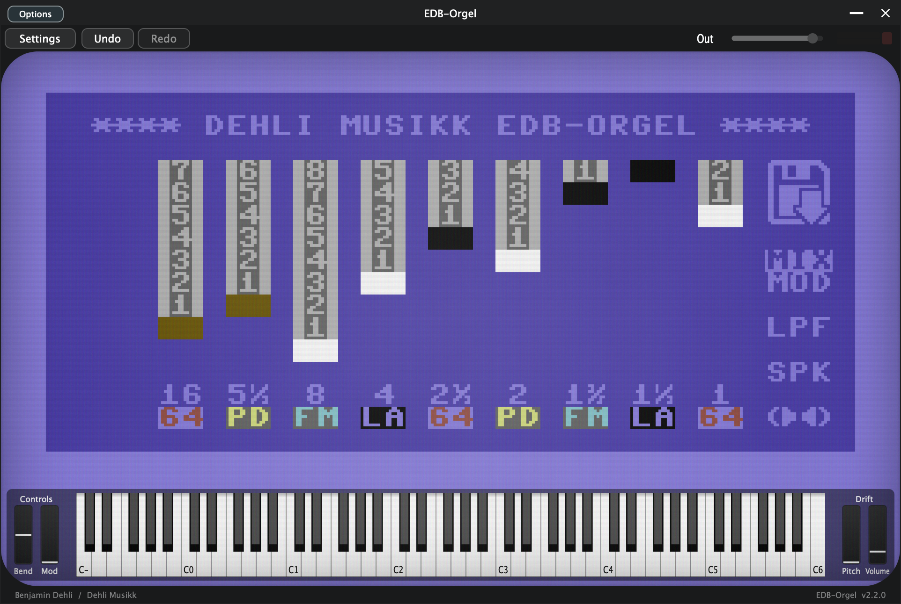
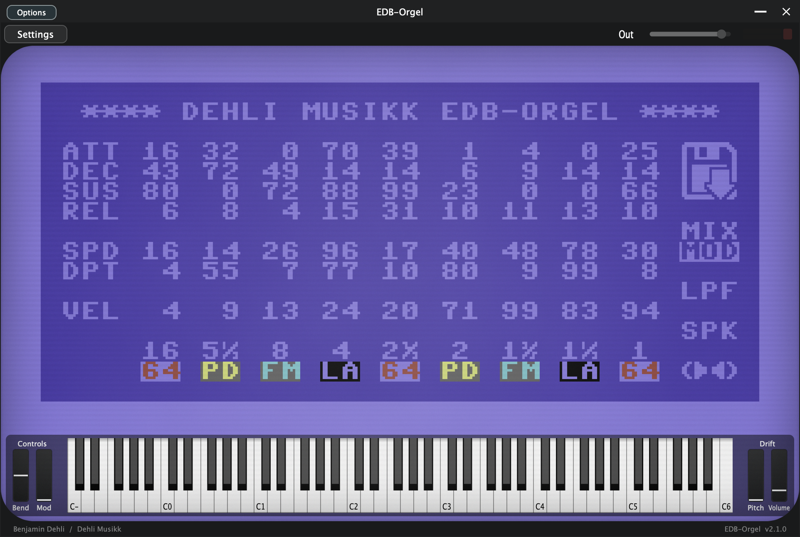
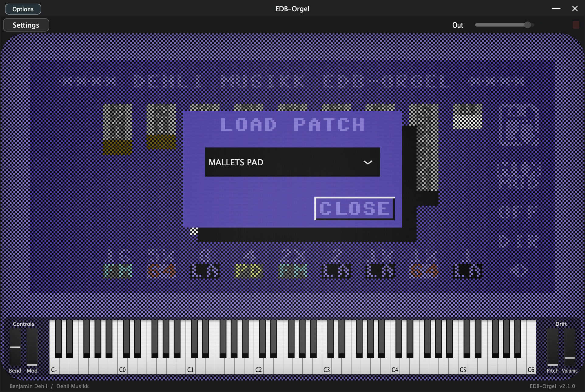
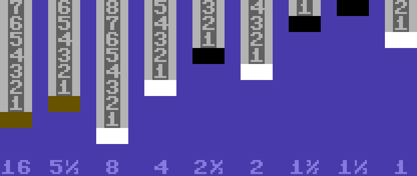
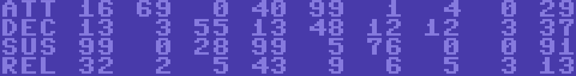
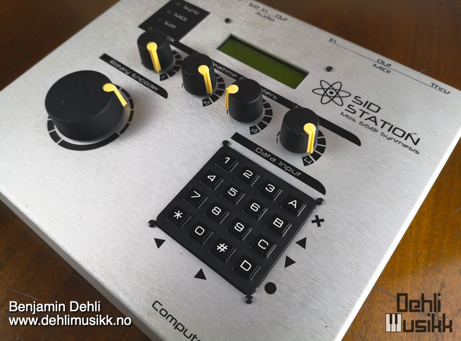
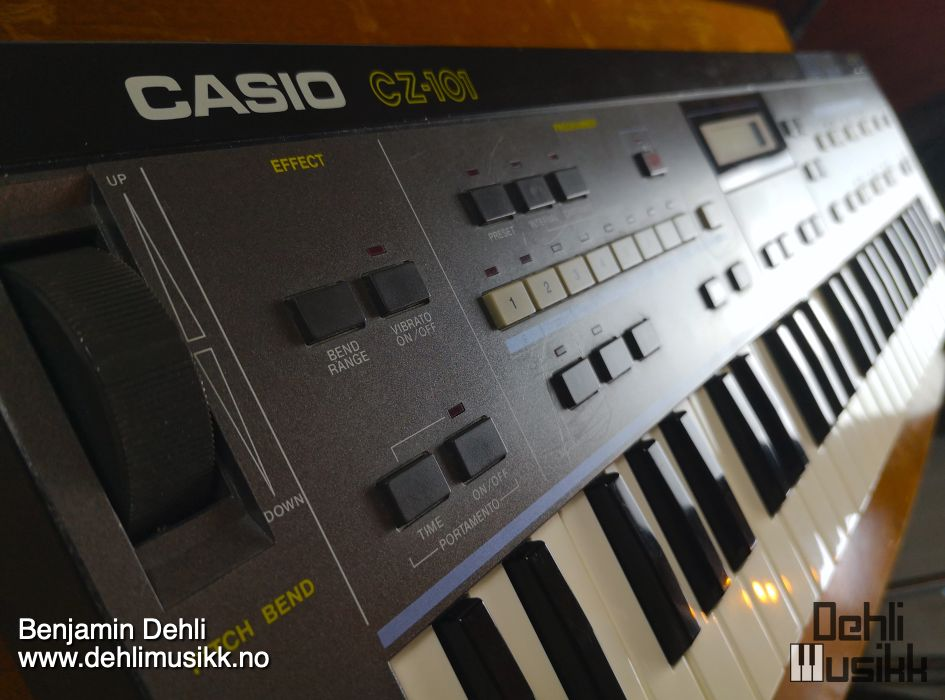
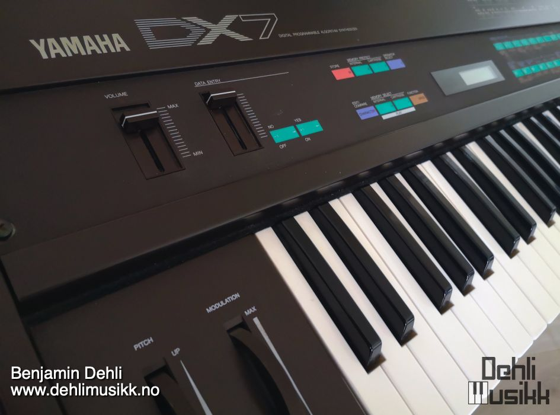
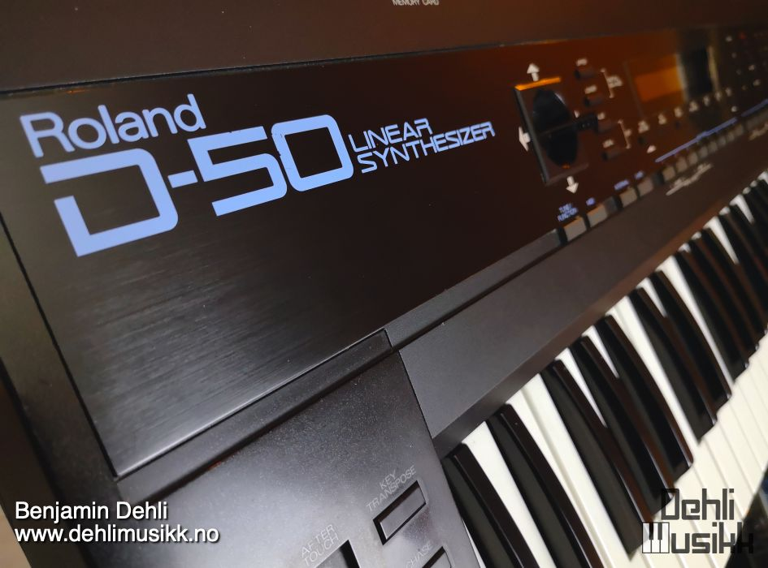

# EDB-Orgel

**[Product page and documentation](https://benjamindehli.github.io/EDB-Orgel/)**

EDB-Orgel delivers the sound of four different digital synthesis types with the workflow of a drawbar organ combined with an analog synthesizer.

## Release notes

### Version 2.2.0 (2026-11-25)

The changes in this release apply to the plugin version only. The DecentSampler version is unchanged.

- The plugin is now also available for Windows and Linux, as VST3 and Standalone. These versions have not yet been tested on Windows and Linux computers.
- The window can be resized from its own size to twice that, by dragging its bottom-right corner or with the new window size setting in the settings menu. The size is saved with the project.
- Added Undo and Redo buttons. Knob moves, button presses and menu choices can be undone, also with Cmd+Z and Shift+Cmd+Z (Ctrl+Z and Shift+Ctrl+Z on Windows and Linux). Automation is not recorded as steps.
- Every control has a name for screen readers such as VoiceOver, and a screen reader goes through the window in a sensible order.
- The buttons and menus have names in the DAW's automation list instead of numbers. Existing automation of them keeps working.
- If the samples cannot be found, the plugin now says so and where they should be, instead of playing silence.
- The plugin tells the DAW how long its reverb and release tails last, so they are not cut off at the end of an export.
- An optional check for new versions. The first time the plugin opens, it asks whether it may check. It reads one small file from the product page and sends nothing about you. A new version is shown in the bottom strip.
- A damaged value in a saved project or preset is set back to its default instead of reaching the sound.
- Built on JUCE 9.0.6.

### Version 2.1.0 (2026-08-01)

The changes in this release apply to the plugin version only. The DecentSampler version is unchanged.

- Added a translucent overlay graphic on top of the interface.
- Keys that are hovered or held on the keyboard are now shaded in a neutral way instead of turning yellow:
  - White keys turn darker.
  - Black keys turn brighter.
- The computer keyboard keeps playing notes even while you adjust a control with the mouse.
- The dropdown menus inside the interface now use colors that match the instrument.

### Version 2.0.0 (2026-07-19)

- Added a plugin version. See the section "The plugin version".
- Corrected the UI values and the polarity for the drawbars.
- Fixed the mislabeled 5 1/3' drawbar control name.
- Fixed the swapped envelope tooltips on the 16' drawbar.
- Renamed the hidden vibrato control, which was mislabeled "Velocity sensitivity 1".
- Removed duplicated tremolo modulator bindings.
- Removed a dead gain binding in the filter OFF state.

### Version 1.0.0 (2024-08-08)

- First version released

## Included formats

- VST3 (macOS, Windows and Linux)
- AU (macOS)
- Standalone application (macOS, Windows and Linux)
- Decent Sampler (macOS, Windows and Linux)

The Windows and Linux versions of the plugin are new and have not yet been tested on those systems.

## The plugin version

The plugin is a self-contained instrument, available as VST3, AU and Standalone.
The graphics are embedded in the plugin, and the samples and impulse responses come in one losslessly compressed file that the installer puts in place, so there is nothing to locate by hand.

The plugin has all the controls and features from the Decent Sampler version, including MIDI learn, the master volume fader with output meter, value readouts for the knobs and full DAW automation.
On top of that, the plugin version adds:

- Drift wheels next to the pitch and modulation wheels, adding a subtle random pitch and volume drift to each voice.
- A velocity curve setting in the settings menu.
- A resizable window, from its own size to twice that.
- Undo and Redo.

## The Decent Sampler version

This version of EDB-Orgel is an instrument preset / sample library for Decent Sampler. If you're new to Decent Sampler, I recommend checking out [this guide][Decent Sampler guide] first.

## Technical specification

|                       | Sample rate | Bit depth | Channels   | Number of files | File size |
|----------------------:|------------:|----------:|------------|----------------:|----------:|
|           **Samples** |      48 kHz |    24 bit | 1 (mono)   |             532 | 974.80 MB |
| **Impulse responses** |      48 kHz |    24 bit | 1 (mono)   |               8 |  85.00 KB |

## User Interface

Each of the nine drawbars has its own volume and sound source. Around them sit the ADSR envelope, amplitude modulation (tremolo) with LFOs, velocity sensitivity, the filter types, speaker simulation, a stereo widener, and vibrato on the modulation wheel.

### Tabs

||||
|:--------------------------------------------:|:------------------------------------------------------:|:----------------------------------------------------:|
|                  Mixer tab                   |                     Modulation tab                     |                     Patch dialog                     |

To accommodate all the controls, they are organized into two separate tabs and a dialog window.

|||
|:------------------------------------------------------:|:----------------------------------------------------------------------------------:|
|                    Open patch dialog                   |                       Toggle between mixer and modulation tab                      |

The button with a floppy disk icon, opens a dialog window for loading predefined patches. The MIX/MOD button allows you to toggle between a mixer view with drawbars, and a modulation view with various modulation controls for further sound customization.

### Drawbars

||
|:--:|
|Drawbar controls in the mixer tab|

Each of the nine drawbars sets the level of one harmonic overtone, and each drawbar can be given its own sound source.

### Sound source

||
|:--:|
|Sound source buttons in the mixer tab|

- 64 (Commodore 64)
  - The MOS Technology 6581 Sound Interface Device (SID) was used in devices such as the Commodore 64 and Elektron SidStation.
- PD (Phase Distortion)
  - Phase distortion synthesis is a technique that was used in Casio synthesizers from the CZ range, such as the Casio CZ-1 and the Casio CZ-101.
- FM (Frequency Modulation)
  - Frequency modulation synthesis is a widely used technique in various devices including AdLib and Sound Blaster sound cards, Sega Genesis (Mega Drive) video game consoles, and synthesizers like the New England Digital Synclavier and the Yamaha DX-7.
- LA (Linear Arithmetic)
  - Linear arithmetic synthesis is a method used in synthesizers such as the Roland MT-32 sound module and the Roland D-50 synthesizer.

### ADSR Envelope

||
|:--:|
|Envelope controls in the modulation tab|

- ATT (attack)
  - Individual attack time of the amplitude envelope for each drawbar
- DEC (decay)
  - Individual decay time of the amplitude envelope for each drawbar
- SUS (sustain)
  - Individual sustain level of the amplitude envelope for each drawbar
- REL (release)
  - Individual release time of the amplitude envelope for each drawbar

### Tremolo

||
|:--:|
|Tremolo controls in the modulation tab|

The speed (SPD) and depth (DPT) controls enable you to modulate the amplitude of the drawbars with the desired speed and depth using the Low-Frequency Oscillator (LFO).

- SPD (speed)
  - Tremolo speed determines the speed at which the modulation occurs
- DPT (depth)
  - Adjust tremolo depth to introduce subtle or pronounced variations in volume

### Velocity sensitivity

||
|:--:|
|Controls for the velocity sensitivity in the modulation tab|

- VEL (velocity sensitivity): Determines whether the velocity should affect the volume of the drawbar

### Filters

||
|:--:|
|Filter select buttons|

EDB-Orgel features the different filter types you get from the SID chip. These are impulse responses (IR) of the filters in the MOS Technology 6581 chip. Cutoff frequency and resonance amount for each filter is set to a fixed value.

- OFF: Filter is disabled
- LPF: Low Pass Filter
- BPF: Band Pass Filter
- L/B: Low Pass Filter and Band Pass Filter
- HPF: High Pass Filter
- L/H: Low Pass Filter and High Pass Filter
- B/H: Band Pass Filter and High Pass Filter
- ALL: Low Pass Filter, Band Pass Filter and High Pass Filter

### Output

||
|:--:|
|Buttons for the output settings|

- DIR (Direct)
  - The direct sound of the line output
- SPK (Speaker)
  - The sound of a tiny computer speaker miced with a Shure SM57

### Mono/Stereo

||
|:--:|
|Buttons for toggling between mono and stereo|

- 1 speaker (mono): Stereo effect is disabled
- 2 speakers (stereo): Stereo effect is enabled

## Equipment used

|                    Name                    |                            Image                           |
| :----------------------------------------: | :--------------------------------------------------------: |
| [Elektron SidStation][Elektron SidStation] |  |
|        [Casio CZ-101][Casio CZ-101]        |                |
|          [Yamaha DX7][Yamaha DX7]          |                    |
|         [Roland D-50][Roland D-50]         |                  |

## About this repository

This repository contains the source for both the Decent Sampler library (the DecentSampler folder) and the plugin version.
The plugin is a thin wrapper around the shared Dehli Musikk sampler engine, and a converter translates the Decent Sampler library into the engine's native preset format at build time.
The audio files are not part of this repository, since the samples are a paid product.
The full version is available from [store.dehlimusikk.no][Gumroad profile].

[Gumroad profile]: https://store.dehlimusikk.no/
[Decent Sampler guide]: https://www.decentsamples.com/how-to-use-decent-sampler/
[Elektron SidStation]: https://www.dehlimusikk.no/equipment/instruments/elektron-sidstation/
[Casio CZ-101]: https://www.dehlimusikk.no/equipment/instruments/casio-cz-101/
[Yamaha DX7]: https://www.dehlimusikk.no/equipment/instruments/yamaha-dx7/
[Roland D-50]: https://www.dehlimusikk.no/equipment/instruments/roland-d-50/
